<p align="center"></p>

<p align="center">
  <a href="https://callmekaue.github.io/starwars-game/"></a>
  
  
  
  
  
</p>

<p align="center">
  
  
  
  
  
</p>

<p align="center">
  <b>Um jogo da memória ambientado nas animações The Clone Wars e Rebels.</b><br>
  Escolha o lado da Força, salte para o hiperespaço e encontre os pares antes que o tempo e as jogadas pesem na sua classificação.<br>
  Tudo em HTML, CSS e JavaScript puro, sem framework, sem build e sem nenhum arquivo de áudio.
</p>

<p align="center"></p>

<h2 align="center">Sumário</h2>

<table align="center">
<tr>
<td><a href="#s1"><b>01</b> &nbsp;O projeto</a><br><sub>Um clássico refeito com a Força</sub></td>
<td><a href="#s2"><b>02</b> &nbsp;Teste agora</a><br><sub>Link e QR code</sub></td>
<td><a href="#s3"><b>03</b> &nbsp;Em movimento</a><br><sub>Do hiperespaço à última carta</sub></td>
</tr>
<tr>
<td><a href="#s4"><b>04</b> &nbsp;Escolha seu lado</a><br><sub>Baralho Jedi e baralho Sith</sub></td>
<td><a href="#s5"><b>05</b> &nbsp;Como jogar</a><br><sub>Níveis, regras e classificação</sub></td>
<td><a href="#s6"><b>06</b> &nbsp;O que foi consertado</a><br><sub>Por que o jogo tinha parado</sub></td>
</tr>
<tr>
<td><a href="#s7"><b>07</b> &nbsp;Por dentro do código</a><br><sub>Arquitetura, estados e efeitos</sub></td>
<td><a href="#s8"><b>08</b> &nbsp;Novos personagens</a><br><sub>Como adicionar fotos e cartas</sub></td>
<td><a href="#s9"><b>09</b> &nbsp;Rodar e publicar</a><br><sub>Servidor local e GitHub Pages</sub></td>
</tr>
</table>

<p align="center"></p>

<a name="s1"></a>
<p align="center"></p>

O jogo da memória foi um dos primeiros projetos que fiz para estudar JavaScript: virar cartas, comparar pares e contar o tempo. Com o tempo, o repositório mudou de nome, os caminhos das imagens quebraram e o jogo **parou de funcionar**.

Esta versão é a reconstrução completa. A lógica foi reescrita, o visual virou uma cena no espaço e o tema ganhou uma regra própria: **o lado que você escolhe define quem aparece nas cartas**. Quem joga de Jedi encontra os heróis da República e os rebeldes; quem joga de Sith enfrenta os vilões, os separatistas e o Império.

<table>
<tr>
<td width="50%" align="center">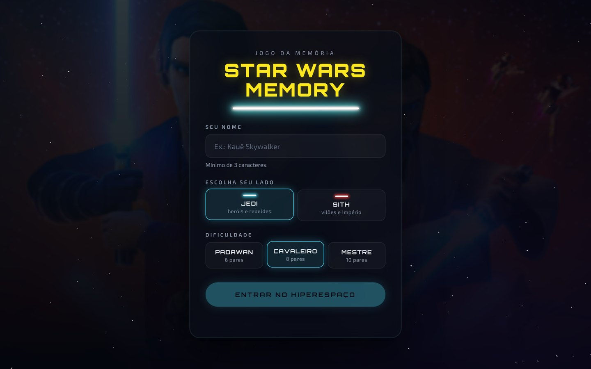<br><sub>Lado Jedi: o jogo inteiro fica azul</sub></td>
<td width="50%" align="center">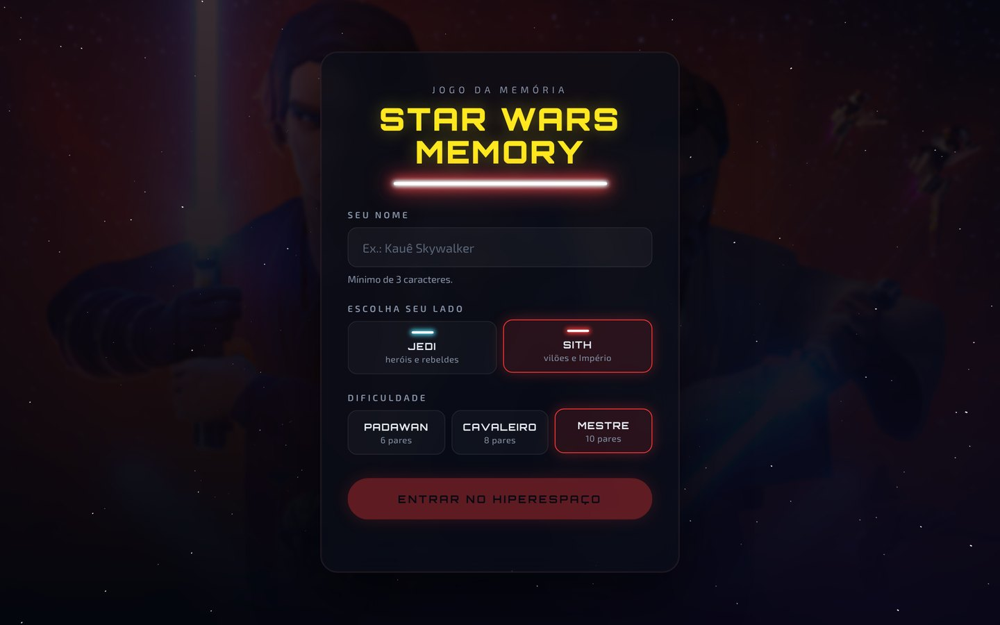<br><sub>Lado Sith: o mesmo jogo, agora vermelho</sub></td>
</tr>
</table>

<a name="s2"></a>
<p align="center"></p>

<table>
<tr>
<td width="260" align="center">
  <a href="https://callmekaue.github.io/starwars-game/"></a><br>
  <sub>Aponte a câmera do celular</sub>
</td>
<td>

**Jogue em:** [https://callmekaue.github.io/starwars-game/](https://callmekaue.github.io/starwars-game/)

1. Digite seu nome (mínimo de 3 letras).
2. Escolha o lado: **Jedi** ou **Sith**.
3. Escolha a dificuldade: **Padawan**, **Cavaleiro** ou **Mestre**.
4. Clique em **Entrar no hiperespaço**.

Funciona no computador e no celular. O recorde de cada nível fica salvo no seu navegador.

</td>
</tr>
</table>

<p align="center"></p>

<a name="s3"></a>
<p align="center"></p>

<h3>A entrada: introdução, escolha do lado e salto para o hiperespaço</h3>
<p align="center"></p>

<h3>A partida: cartas distribuídas, erro, pares encontrados e vitória</h3>
<p align="center">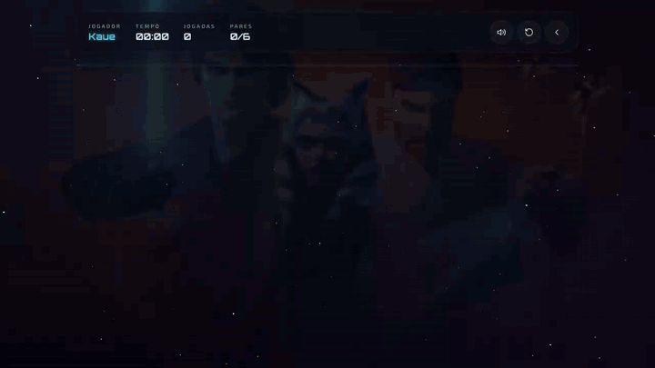</p>

<table>
<tr>
<td width="38%" align="center">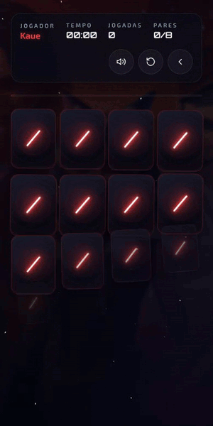</td>
<td>

<h3>No celular também</h3>

O tabuleiro se reorganiza em colunas menores, o painel do topo se divide em duas linhas e os toques funcionam como cliques. Os nomes das cartas somem nas telas pequenas para deixar as imagens respirarem.

<h3>Cada animação tem um propósito</h3>

| Momento | O que acontece |
|---|---|
| Início | As cartas caem uma a uma no tabuleiro |
| Passar o mouse | A carta inclina em 3D e um reflexo varre o verso |
| Virar | Rotação 3D com o rosto do personagem |
| Errar | As duas cartas tremem e ficam vermelhas |
| Acertar | Brilho do sabre, faíscas e aviso com o nome |
| Vencer | Estrelas aceleram e a classificação acende |

</td>
</tr>
</table>

<p align="center"></p>

<a name="s4"></a>
<p align="center"></p>

Cada lado tem o **próprio baralho**, com personagens de **The Clone Wars** e de **Rebels**. Como o baralho é maior que o número de pares da partida, o sorteio muda a cada jogo. Toda carta mostra uma etiqueta com a série de origem.

<table>
<tr>
<td width="50%" valign="top">

<h3 align="center">Jedi · heróis e rebeldes</h3>

| Clone Wars | Rebels |
|---|---|
| Anakin Skywalker | Kanan Jarrus |
| Obi-Wan Kenobi | Ezra Bridger |
| Ahsoka Tano | Hera Syndulla |
| Mestre Yoda | Sabine Wren |
| Padmé Amidala | Zeb Orrelios |
| Capitão Rex | Chopper |
| C-3PO · R2-D2 | |
| Jar Jar Binks | |
| Mace Windu · Plo Koon | |
| Kit Fisto | |
| Comandante Cody · Echo | |

<p align="center"><sub><b>20 personagens</b></sub></p>

</td>
<td width="50%" valign="top">

<h3 align="center">Sith · vilões e Império</h3>

| Clone Wars | Rebels |
|---|---|
| Darth Maul | Darth Vader |
| Darth Sidious | Grande Inquisidor |
| Conde Dookan | Sétima Irmã |
| Asajj Ventress | Quinto Irmão |
| General Grievous | Grande Almirante Thrawn |
| Savage Opress | Governador Tarkin |
| Mãe Talzin | |
| Cad Bane | |
| Barriss Offee | |
| Pre Vizsla | |

<p align="center"><sub><b>16 personagens</b></sub></p>

</td>
</tr>
<tr>
<td align="center">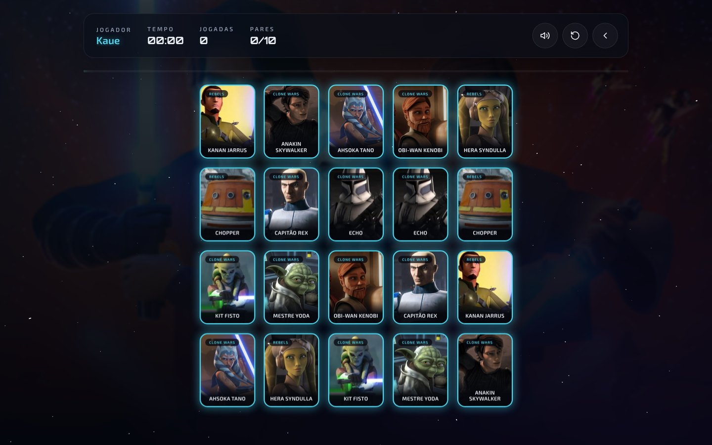</td>
<td align="center">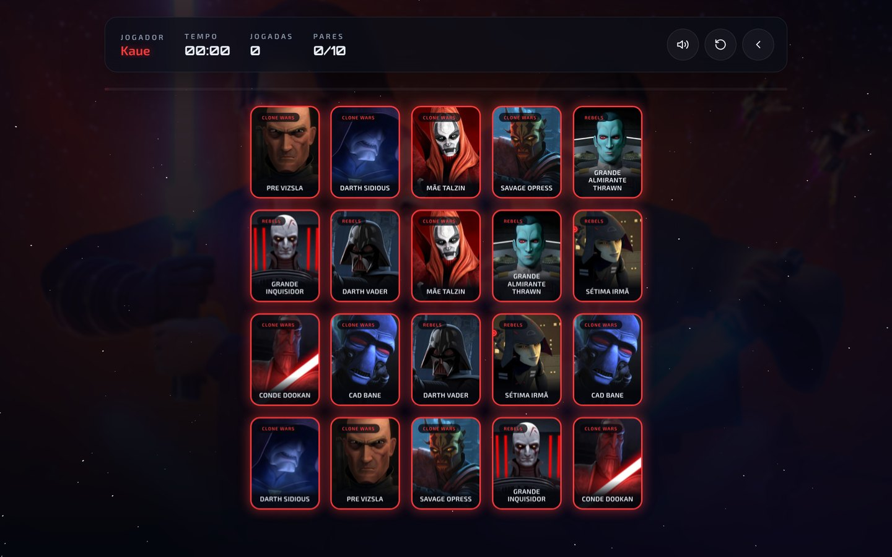</td>
</tr>
</table>

> Barriss Offee começa como Jedi, mas trai a Ordem em The Clone Wars. Por isso ela joga no baralho Sith.

<a name="s5"></a>
<p align="center"></p>

| Nível | Pares | Cartas | Tabuleiro |
|---|---|---|---|
| **Padawan** | 6 | 12 | 4 × 3 |
| **Cavaleiro** | 8 | 16 | 4 × 4 |
| **Mestre** | 10 | 20 | 5 × 4 |

- O cronômetro só começa quando você vira a **primeira carta**.
- Cada tentativa de formar um par conta como **uma jogada**.
- Enquanto duas cartas estão sendo comparadas, o tabuleiro fica travado: não dá para virar uma terceira.
- O recorde é salvo **por nível**: menor tempo e, no empate, menos jogadas.

<table>
<tr>
<td width="55%" valign="top">

<h3>Classificação em sabres</h3>

O jogo compara suas jogadas com o mínimo possível (uma por par) e acende de 1 a 3 sabres. O título muda conforme o lado:

| Sabres | Jedi | Sith |
|---|---|---|
| 3 | Mestre da Força | Lorde Sombrio |
| 2 | Cavaleiro habilidoso | Lorde Sith |
| 1 | Padawan promissor | Aprendiz Sith |

<h3>Controles</h3>

| Ação | Como |
|---|---|
| Virar carta | Clique, toque ou **Tab** + **Enter** |
| Reiniciar | Botão de reiniciar no topo |
| Som | Botão de som (a escolha fica salva) |
| Menu | Botão de voltar |

</td>
<td width="45%" align="center" valign="top">
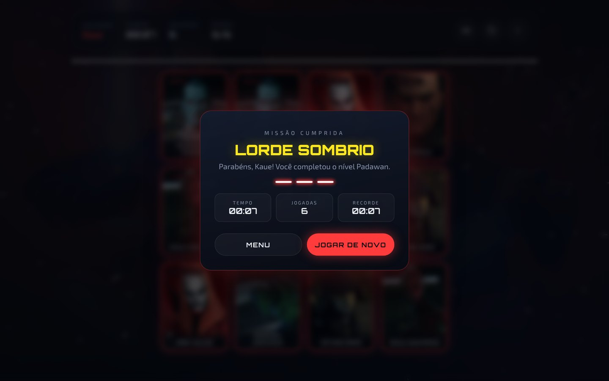
<br><sub>Vitória no lado Sith com 3 sabres</sub>
</td>
</tr>
</table>

<p align="center"></p>

<a name="s6"></a>
<p align="center"></p>

O jogo antigo não quebrou por causa de uma linha de lógica, e sim por **caminhos de arquivo**. Quando o projeto saiu de uma pasta chamada `Game`, tudo que apontava para `/Game/images/...` deixou de existir.

| Problema | O que acontecia | Como ficou |
|---|---|---|
| Caminhos absolutos `/Game/images/...` | O verso da carta não carregava, ficava transparente e **o rosto do personagem aparecia por trás**. Todas as cartas ficavam visíveis desde o início. O fundo e o ícone também sumiam. | Todos os caminhos são relativos (`../images/`), então o jogo roda em qualquer pasta e no GitHub Pages. |
| `reset.css` agressivo | Colocava `margin-bottom: 20px` e uma fonte pixelada em **todos** os elementos, desalinhando o layout. | Reset enxuto, só com o necessário. |
| Clique duplo na mesma carta | Dava para formar "par" com a mesma carta. | A carta já virada é ignorada e o tabuleiro trava durante a comparação. |
| Embaralhamento com `sort(() => Math.random() - 0.5)` | Distribuição viciada: algumas posições se repetiam mais. | Algoritmo **Fisher-Yates**, com chance igual para cada ordem. |
| Nomes de arquivo com espaço | `obi wan.jpg` e `jar jar.jpg` quebram em alguns servidores. | Renomeados para `obi-wan.jpg` e `jar-jar.jpg`. |
| `alert()` no fim | Janela nativa do navegador, sem estatísticas. | Janela própria com tempo, jogadas, recorde e classificação. |
| Sem nome de jogador | Abrir `game.html` direto mostrava "null" no topo. | Sem nome, o jogo volta para a tela inicial. |

<a name="s7"></a>
<p align="center"></p>

<h3>Duas páginas, um tema</h3>

A tela inicial grava as escolhas no `localStorage`; a página do jogo lê essas escolhas e monta o tabuleiro. O tema (azul ou vermelho) é uma única variável CSS, trocada pelo atributo `data-side` no `<body>`.

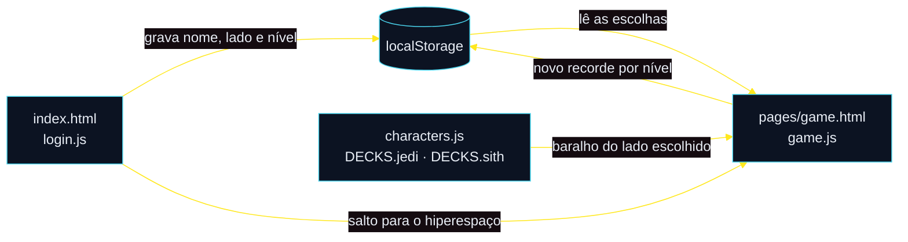

<h3>O ciclo de uma jogada</h3>

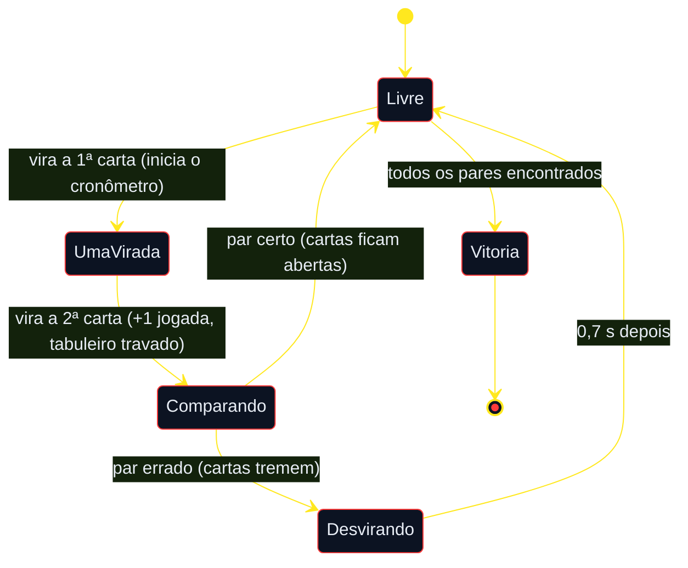

<table>
<tr>
<td width="33%" valign="top">

**Campo de estrelas**<br>
<sub>Canvas 2D com centenas de estrelas em perspectiva. O mouse desloca o centro da cena e, no salto para o hiperespaço, a velocidade sobe e as estrelas viram riscos.</sub>

</td>
<td width="33%" valign="top">

**Cartas em 3D**<br>
<sub>`transform-style: preserve-3d` e `backface-visibility: hidden`. O verso holográfico é feito só com gradientes CSS, sem imagem.</sub>

</td>
<td width="33%" valign="top">

**Sons sintetizados**<br>
<sub>Virar, acertar, errar, acender o sabre e vencer: tudo gerado com osciladores e ruído filtrado da Web Audio API.</sub>

</td>
</tr>
<tr>
<td valign="top">

**Sorteio inteligente**<br>
<sub>Antes de montar o tabuleiro, o jogo testa quais imagens existem e dá prioridade a elas. Personagens sem foto viram uma carta holográfica com as iniciais.</sub>

</td>
<td valign="top">

**Acessível**<br>
<sub>As cartas são botões: dá para jogar só com o teclado. Quem ativa "reduzir movimento" no sistema recebe a versão sem animações.</sub>

</td>
<td valign="top">

**Zero dependências**<br>
<sub>Nenhuma biblioteca, nenhum `npm install`. Cerca de 1.800 linhas entre HTML, CSS e JavaScript.</sub>

</td>
</tr>
</table>

<p align="center"></p>

<a name="s8"></a>
<p align="center"></p>

Hoje **os 36 personagens já têm imagem**. Os baralhos ficam em `js/characters.js`, e cada personagem usa a imagem `images/<id>.jpg`:

```js
{ id: 'vader', name: 'Darth Vader', series: 'Rebels' }
//  ↑ usa images/vader.jpg
```

**Para colocar a foto de um personagem:** salve a imagem na pasta `images/` com o nome exato do `id`. Uma imagem `.jpg` quadrada, com cerca de 500 px, fica ótima. Não precisa mexer no código: na próxima partida a foto aparece sozinha.

**Para criar um personagem novo:** adicione uma linha no baralho do lado certo e coloque a imagem com o mesmo `id`.

<details>
<summary><b>Nomes de arquivo esperados para cada personagem</b></summary>

<br>

| Lado | Arquivos |
|---|---|
| Jedi | `anakin` `obi-wan` `ahsoka` `yoda` `padme` `rex` `c3po` `jar-jar` `r2d2` `mace-windu` `plo-koon` `kit-fisto` `cody` `echo` `kanan` `ezra` `hera` `sabine` `zeb` `chopper` |
| Sith | `maul` `sidious` `dooku` `ventress` `grievous` `savage` `talzin` `cad-bane` `barris` `pre-vizsla` `vader` `grande-inquisidor` `setima-irma` `quinto-irmao` `thrawn` `tarkin` |

Todos com a extensão `.jpg`, dentro de `images/`.

</details>

<a name="s9"></a>
<p align="center"></p>

<h3>Estrutura</h3>

```text
starwars-game/
├── index.html                  # tela inicial: nome, lado da Força e dificuldade
├── pages/
│   └── game.html               # tabuleiro, painel e janela de vitória
├── css/
│   ├── reset.css
│   ├── style.css               # tema, campo de estrelas, botões e tela inicial
│   └── game.css                # cartas, animações e responsividade
├── js/
│   ├── stars.js                # campo de estrelas em canvas e hiperespaço
│   ├── sound.js                # efeitos sonoros com Web Audio API
│   ├── login.js                # validação e escolhas da tela inicial
│   ├── characters.js           # baralhos Jedi e Sith
│   └── game.js                 # lógica do jogo da memória
├── images/                     # personagens, fundo e ícone
├── starwars-readme-arquivos/   # banner, GIFs e imagens deste README
└── README.md
```

<h3>Rodar no seu computador</h3>

Não há instalação nem build. Baixe o repositório e abra o `index.html`. Para testar exatamente como no GitHub Pages, use um servidor local:

```bash
git clone https://github.com/callmekaue/starwars-game.git
cd starwars-game
python -m http.server 8080
# ou
npx serve .
```

Depois abra `http://localhost:8080`.

<h3>Publicar no GitHub Pages</h3>

1. Envie os arquivos para o repositório, com o `index.html` na raiz.
2. Vá em **Settings → Pages**, escolha **Deploy from a branch**, a branch `main` e a pasta `/ (root)`.
3. Em alguns minutos o jogo fica disponível em `https://callmekaue.github.io/starwars-game/`.

<p align="center"></p>

<p align="center"></p>

<div align="center">

**Star Wars Memory** · um clássico do navegador, refeito com a Força

Desenvolvido por **[Cicero Kauê Alves da Silva](https://github.com/callmekaue)**<br>
<sub>Engenharia de Software · UNICID</sub>

<sub>Projeto de estudo de Front-End, sem fins comerciais e sem vínculo oficial com a saga. Star Wars, seus personagens e imagens pertencem à Lucasfilm Ltd. e à Disney.</sub>

</div>
